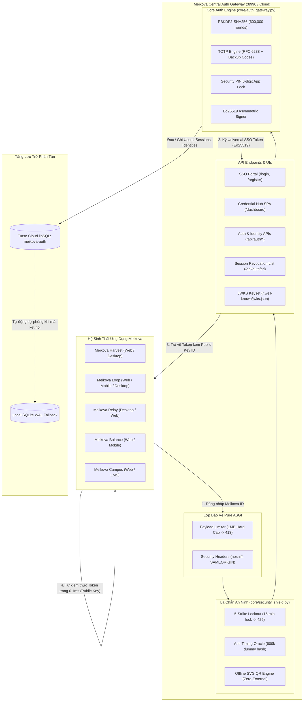

# Meikova Auth

<div align="center">


[](https://github.com/Meikova/meikova-auth/releases)
[](https://github.com/Meikova/meikova-auth)
[](https://www.python.org/)
[](https://fastapi.tiangolo.com/)
[](https://turso.tech/)
[](https://tools.ietf.org/html/rfc8032)
[](https://owasp.org/Top10/)
[](LICENSE)

**Cổng xác thực tập trung, Universal Single Sign-On (SSO) Ed25519, Trung tâm quản lý thông tin xác thực & danh tính đa nền tảng và Lá chắn an ninh mạng OWASP Top 10 cho toàn bộ hệ sinh thái Meikova.**

[Cổng Đăng Nhập Trực Tuyến](https://meikova-auth.onrender.com) | [Tài Liệu Kỹ Thuật](docs/GOOGLE-CREDENTIALS-GUIDE.md) | [Báo Lỗi](https://github.com/Meikova/meikova-auth/issues)

</div>

---

## 1. Tổng quan hệ thống

Meikova Auth là dịch vụ Identity Provider (IdP), Cổng xác thực tập trung (Universal SSO Gateway) và Trung tâm quản trị thông tin xác thực (Credential & Identity Management Hub) cho toàn bộ hệ sinh thái Meikova Platform (Meikova Harvest, Meikova Loop, Meikova Relay, Meikova Balance, Meikova Campus, Meikova Exchange, Meikova Shield...).

- **Universal SSO Ed25519**: Toàn bộ token đăng nhập được ký mật mã bất đối xứng Ed25519 (RFC 8032). Tất cả ứng dụng con tự kiểm thực tính hợp lệ của token cục bộ trong **0.1ms** bằng Public Key mà không cần gọi API qua mạng.
- **Trung tâm quản trị xác thực (Credential Hub SPA)**: Cung cấp Web App quản lý tài khoản chuyên sâu tại `/dashboard`, `/account` và `/app` (hồ sơ, phiên đăng nhập, khóa bảo mật 2FA/PIN, mã truy cập cá nhân PAT, kho ứng dụng và nhật ký kiểm toán).
- **Bảo vệ tài khoản đa tầng (Dual-Layer Protection)**:
  * **2FA TOTP (RFC 6238)**: Xác thực 2 bước theo thời gian thực tương thích Google Authenticator / Authy kèm 8 mã dự phòng khẩn cấp (Emergency Backup Codes).
  * **Mã PIN bảo mật 6 số (Security PIN App Lock)**: Khóa màn hình ứng dụng và thẩm định trước mọi tác vụ nhạy cảm (xem khóa bí mật, đổi mật khẩu, cấp quyền PAT).
- **Lá chắn an ninh mạng OWASP Top 10 (2021/2025)**: Triển khai trực tiếp lớp lọc Pure ASGI chặn payload vượt ngưỡng 1MB (HTTP 413), cơ chế khóa 5-Strike Lockout chống Brute-Force (khóa 15 phút, HTTP 429), bộ cân bằng thời gian phản hồi triệt tiêu Timing Attack (Anti-Timing Oracle Equalizer chạy 600.000 vòng băm PBKDF2), engine mã QR vector SVG nội bộ (Zero-External Dependency) và danh sách thu hồi phiên tức thì (`/api/auth/crl`).
- **Cơ sở dữ liệu phân tán Turso Cloud libSQL**: Dữ liệu tài khoản, định danh và phiên đăng nhập đồng bộ toàn cầu qua Turso Cloud, tích hợp cơ chế tự động chuyển vùng dự phòng (Fallback) về SQLite WAL cục bộ khi mất mạng.
- **Kiến trúc đa nền tảng (Multi-Platform)**: Hỗ trợ Web Responsive SPA, Desktop Native Shell qua Microsoft Edge WebView2 (`meikova_auth_desktop.py`) và Mobile PWA chuẩn hóa.

---

## 2. Tính năng nổi bật

### Cổng đăng nhập tập trung (Universal SSO Portal)

- **Đăng ký và Đăng nhập hợp nhất**: Một tài khoản Meikova ID truy cập xuyên suốt toàn bộ ứng dụng trong hệ sinh thái trên mọi nền tảng (Web, Desktop, Mobile PWA).
- **Liên kết danh tính Google OAuth 1-Click**: Tích hợp Google Identity Services (GIS) với cơ chế tự động liên kết tài khoản dựa trên email đã xác minh, bảo đảm tính duy nhất và triệt tiêu trùng lặp.
- **Khóa bảo mật Ed25519 & JWKS chuẩn RFC 8037**: Xuất bản bộ khóa công khai tại `/.well-known/jwks.json` và `/api/auth/keys` cho phép các ứng dụng OAuth2/OIDC chuẩn hóa tích hợp dễ dàng.

### Trung tâm quản trị xác thực & danh tính (Credential Hub SPA - `/dashboard`)

Ứng dụng web Single Page Application (SPA) xây dựng theo phong cách Ambient Dark OKLCH, 100% Inline Vector SVG, Zero-Native Dialogs/Inputs/Scrollbars:

1. **Tổng quan danh tính (Overview)**: Hiển thị thẻ định danh người dùng, trạng thái bảo vệ 2FA/PIN, tóm tắt các ứng dụng đã liên kết và thiết bị đang đăng nhập.
2. **Hồ sơ người dùng (Profile)**: Cập nhật tên hiển thị, tiểu sử, số điện thoại, avatar phát quang thương hiệu và định danh duy nhất (`usr_<hex>`).
3. **Trung tâm an ninh đa tầng (Security)**:
   - Thay đổi mật khẩu tài khoản với cơ chế kiểm tra mật khẩu hiện tại (PBKDF2-SHA256 600.000 vòng).
   - Thiết lập, đổi và vô hiệu hóa **Mã PIN bảo mật 6 số** (App Lock).
   - Thiết lập và quản lý **Xác thực 2 yếu tố TOTP (RFC 6238)** kèm mã QR quét bảo mật và bộ mã dự phòng khẩn cấp.
4. **Giám sát phiên làm việc (Sessions)**:
   - Giám sát danh sách thiết bị kết nối thời gian thực (IP, trình duyệt, hệ điều hành, thời điểm đăng nhập gần nhất).
   - Thu hồi từng phiên đăng nhập hoặc thu hồi toàn bộ các phiên khác (Remote Session Revocation) chỉ với 1 thao tác.
5. **Quản lý mã truy cập API (Personal Access Tokens - PAT)**:
   - Tạo token lập trình viên (`mkv_pat_<hex>`) với phạm vi phân quyền (`read`, `write`, `admin`) và thời hạn tùy chọn.
   - Lưu trữ token bằng hàm băm SHA-256 một chiều, bảo vệ tuyệt đối ngay cả khi cơ sở dữ liệu bị lộ.
6. **Kho ứng dụng hệ sinh thái (App Directory)**: Danh mục truy cập nhanh toàn bộ các sản phẩm chính thức trong hệ sinh thái Meikova.
7. **Nhật ký kiểm toán bảo mật (Audit Trail)**: Ghi vết bất biến mọi hành động nhạy cảm (đăng nhập, đổi mật khẩu, thiết lập PIN/TOTP, thu hồi phiên).

### Kiến trúc phòng thủ OWASP Top 10 (Cyber Defense Architecture)

| Mã OWASP | Hạng mục an ninh | Cơ chế triển khai thực tế trên Meikova Auth |
| :--- | :--- | :--- |
| **A01:2021** | Broken Access Control | Cung cấp danh sách thu hồi phiên `/api/auth/crl`, thu hồi phiên tức thời, phân quyền chặt chẽ theo User ID và token scope (`read`, `write`, `admin`). |
| **A02:2021** | Cryptographic Failures | Sử dụng 100% `secrets` CSPRNG cho PIN, Session, Token và Salt; PBKDF2 600.000 vòng; ký token Ed25519 khóa tĩnh PEM. |
| **A03:2021** | Injection | Parameterized SQL queries (`?`) 100% trên cả SQLite và Turso Cloud libSQL; validation chặt chẽ dữ liệu đầu vào. |
| **A04:2021** | Insecure Design | Cơ chế **5-Strike Lockout**: Nhập sai PIN / TOTP / Mật khẩu 5 lần liên tiếp sẽ bị khóa 15 phút (`429 Too Many Requests` + header `Retry-After: 900`). |
| **A05:2021** | Security Misconfiguration | Hardened HTTP Headers trên 100% response: `nosniff`, `SAMEORIGIN`, `strict-origin-when-cross-origin`, `1; mode=block`. Phân lập CORS chặt chẽ. |
| **A06:2021** | Vulnerable Components | Zero-bloat dependency policy. Mọi thư viện đều được chọn lọc tối thiểu và cập nhật định kỳ. |
| **A07:2021** | Identification & Auth Failures | **Anti-Timing Oracle Equalizer**: Khi tài khoản không tồn tại, tự động chạy hàm băm giả lập `dummy_pbkdf2_hash` 600.000 vòng để thời gian phản hồi đồng nhất (~200-250ms), triệt tiêu Account Enumeration. |
| **A08:2021** | Software & Data Integrity | Đối soát mã băm SHA-256 cho installer và asset tải về qua GitHub Release API. |
| **A09:2021** | Security Logging & Monitoring | Ghi nhật ký audit đầy đủ, tự động phát sinh log cảnh báo mức độ `SECURITY_ALERT` khi phát hiện brute-force hoặc kích hoạt 5-Strike Lockout. |
| **A10:2021** | SSRF & DoS/DDoS Mitigation | **Pure ASGI 1MB Payload Limiter**: Chặn ngay từ tầng ASGI mọi request có Content-Length hoặc Body > 1MB (`413 Payload Too Large`). **Offline SVG QR Engine**: Tự vẽ mã QR bằng Python stdlib, không gọi API bên thứ 3 (`api.qrserver.com`). |

---

## 3. Kiến trúc hệ thống và luồng dữ liệu



---

## 4. Danh mục API RESTful toàn diện

| Phương thức | Đường dẫn Endpoint | Quyền hạn | Mô tả chức năng |
| :--- | :--- | :---: | :--- |
| `GET` | `/` | Public | Phân phối Web Credential Manager SPA (Browser) hoặc Metadata JSON (API client) |
| `GET` | `/dashboard`, `/account`, `/app` | Public | Giao diện Trung tâm quản trị xác thực và danh tính SPA |
| `GET` | `/login`, `/register` | Public | Giao diện Universal SSO Portal tập trung |
| `GET` | `/health`, `/api/health` | Public | Kiểm tra trạng thái máy chủ, backend cơ sở dữ liệu và khóa Ed25519 |
| `GET` | `/.well-known/jwks.json` | Public | Bộ khóa công khai JWKS chuẩn RFC 8037 |
| `GET` | `/api/auth/keys` | Public | Khóa công khai Ed25519 định dạng PEM |
| `GET` | `/api/auth/config` | Public | Cấu hình Google Client ID cho client GIS |
| `POST` | `/api/auth/register` | Public | Đăng ký tài khoản Meikova ID mới |
| `POST` | `/api/auth/login` | Public | Đăng nhập bằng Username/Email và Mật khẩu (hỗ trợ phân luồng 2FA) |
| `POST` | `/api/auth/google` | Public | Đăng nhập / Đăng ký 1-click tự động qua Google ID Token |
| `GET` | `/api/auth/verify` | Bearer Token | Kiểm thực tính hợp lệ của Token qua API |
| `GET` | `/api/auth/me` | Bearer Token | Lấy thông tin hồ sơ và định danh của tài khoản hiện tại |
| `PATCH` | `/api/auth/profile` | Bearer Token | Cập nhật hồ sơ người dùng (tên hiển thị, avatar, bio, điện thoại) |
| `POST` | `/api/auth/password` | Bearer Token | Đổi mật khẩu tài khoản (yêu cầu mật khẩu cũ) |
| `GET` | `/api/auth/sessions` | Bearer Token | Liệt kê danh sách các phiên đăng nhập và thiết bị đang kết nối |
| `DELETE` | `/api/auth/sessions/{id}` | Bearer Token | Thu hồi một phiên đăng nhập cụ thể từ xa |
| `POST` | `/api/auth/sessions/revoke-others` | Bearer Token | Thu hồi toàn bộ các phiên làm việc khác ngoại trừ phiên hiện tại |
| `GET` | `/api/auth/crl` | Public / Token | Danh sách thu hồi phiên (Certificate/Session Revocation List) |
| `GET` | `/api/auth/tokens` | Bearer Token | Danh sách mã truy cập cá nhân (Personal Access Tokens - PAT) |
| `POST` | `/api/auth/tokens` | Bearer Token | Tạo mã PAT mới (`mkv_pat_<hex>`) kèm quyền hạn và ngày hết hạn |
| `DELETE` | `/api/auth/tokens/{id}` | Bearer Token | Thu hồi mã PAT |
| `GET` | `/api/auth/identities` | Bearer Token | Danh sách các định danh OAuth liên kết (Google, Meikova) |
| `GET` | `/api/auth/apps` | Bearer Token | Danh sách ứng dụng hệ sinh thái đã cấp quyền |
| `GET` | `/api/auth/audit` | Bearer Token | Nhật ký kiểm toán bảo mật bất biến của tài khoản |
| `GET` | `/api/auth/security/status` | Bearer Token | Trạng thái kích hoạt 2FA TOTP và Mã PIN bảo mật |
| `POST` | `/api/auth/totp/setup` | Bearer Token | Khởi tạo bí mật TOTP và URL `otpauth://` |
| `POST` | `/api/auth/totp/enable` | Bearer Token | Kích hoạt 2FA TOTP kèm sinh 8 mã dự phòng khẩn cấp |
| `POST` | `/api/auth/totp/verify` | Temp Token | Kiểm thực mã OTP 6 số hoặc mã dự phòng khi đăng nhập |
| `POST` | `/api/auth/totp/disable` | Bearer Token | Tắt xác thực 2 bước TOTP |
| `POST` | `/api/auth/pin/setup` | Bearer Token | Thiết lập mã PIN bảo mật 6 số |
| `POST` | `/api/auth/pin/verify` | Bearer Token | Kiểm thực mã PIN 6 số (bảo vệ bởi 5-Strike Lockout) |
| `POST` | `/api/auth/pin/change` | Bearer Token | Đổi mã PIN bảo mật 6 số |
| `POST` | `/api/auth/pin/disable` | Bearer Token | Vô hiệu hóa mã PIN |
| `GET` | `/api/host-info` | Public | Khám phá mạng động (LAN IP, Tailscale IP, Active Origin) |
| `GET` | `/api/qr` | Public | Xuất mã QR vector SVG offline kết nối thiết bị di động |
| `GET` | `/api/download/app/{target}` | Public | Phân giải liên kết tải bộ cài đặt native đối soát GitHub Release |
| `GET` | `/api/tunnel/status` | Public | Trạng thái đường hầm Cloudflare Quick Tunnel |
| `POST` | `/api/tunnel/start`, `stop`, `restart` | Public | Điều khiển vòng đời đường hầm Quick Tunnel |

---

## 5. Hướng dẫn phát triển & Kiểm thử chất lượng

### Yêu cầu môi trường

- Python 3.11+
- Git

### Cài đặt dependencies

```bash
git clone https://github.com/Meikova/meikova-auth.git
cd meikova-auth
pip install -r requirements.txt
```

### Chạy kiểm thử tự động (69 Điểm Kiểm Định - Exit Code 0)

Dự án triển khai đầy đủ 3 bộ test tự động khép kín, đảm bảo không có bất kỳ regression nào:

```bash
# 1. Bộ kiểm định chức năng Auth Gateway & Credential Hub (52/52 điểm kiểm định)
python tests/test_auth_server.py

# 2. Bộ kiểm định an ninh mạng OWASP Top 10 Penetration Test (10/10 bài kiểm tra thâm nhập)
python tests/test_auth_security_pentest.py

# 3. Bộ kiểm định tuân thủ nhận diện thương hiệu Meikova (7/7 điểm kiểm định)
python tests/test_brand_assets.py
```

### Khởi chạy máy chủ phát triển cục bộ

```bash
python server.py --host 0.0.0.0 --port 8990
```

Truy cập:
- **Trung tâm quản trị xác thực (SPA)**: `http://localhost:8990/dashboard`
- **Cổng đăng nhập SSO**: `http://localhost:8990/login`
- **Tài liệu API Swagger UI**: `http://localhost:8990/docs`

### Khởi chạy ứng dụng Desktop Native (WebView2)

```bash
python meikova_auth_desktop.py
```

---

## 6. Giao tiếp kiểm thực Token (Universal SSO Client Integration)

Ứng dụng con không cần gửi request kiểm tra token qua mạng mỗi lần xử lý. Quá trình kiểm thực diễn ra 100% offline trong **~0.1ms** qua Public Key Ed25519:

### Python Client Integration

```python
import base64
import json
import time
from cryptography.hazmat.primitives.asymmetric import ed25519
from cryptography.hazmat.primitives import serialization

def verify_sso_token(token: str, public_key_pem: str) -> dict | None:
    parts = token.strip().split(".")
    if len(parts) != 3:
        return None
    h_b64, p_b64, sig_b64 = parts
    try:
        signing_input = f"{h_b64}.{p_b64}".encode("utf-8")
        rem = len(sig_b64) % 4
        sig = base64.urlsafe_b64decode(sig_b64 + ("=" * (4 - rem) if rem else ""))
        pub = serialization.load_pem_public_key(public_key_pem.encode("utf-8"))
        pub.verify(sig, signing_input)
        payload = json.loads(base64.urlsafe_b64decode(p_b64 + ("=" * ((4 - len(p_b64) % 4) % 4))).decode("utf-8"))
        if payload.get("exp") and payload["exp"] < time.time():
            return None
        return payload
    except Exception:
        return None
```

### Node.js / TypeScript Client Integration

```javascript
const crypto = require('crypto');

function verifySsoToken(token, publicKeyPem) {
  const parts = String(token).trim().split('.');
  if (parts.length !== 3) return null;
  const [hB64, pB64, sigB64] = parts;
  try {
    const signingInput = Buffer.from(`${hB64}.${pB64}`);
    const sig = Buffer.from(sigB64, 'base64url');
    const isValid = crypto.verify(null, signingInput, publicKeyPem, sig);
    if (!isValid) return null;
    const payload = JSON.parse(Buffer.from(pB64, 'base64url').toString('utf8'));
    if (payload.exp && payload.exp < Math.floor(Date.now() / 1000)) return null;
    return payload;
  } catch {
    return null;
  }
}
```

---

## 7. Cấu hình và Biến môi trường (.env)

| Tên biến | Bắt buộc | Mô tả | Giá trị mẫu |
| :--- | :---: | :--- | :--- |
| `AUTH_TURSO_DATABASE_URL` | Có | Địa chỉ kết nối Turso Cloud SQLite | `https://meikova-auth-m3ik18dp.aws-ap-northeast-1.turso.io` |
| `AUTH_TURSO_AUTH_TOKEN` | Có | JWT Token kết nối Turso Cloud | `eyJhbGciOiJFZERTQSIsInR5cCI6IkpXVCJ9...` |
| `AUTH_PRIVATE_KEY_B64` | Có | Khóa riêng tư Ed25519 (Base64 PEM) | `LS0tLS1CRUdJTiBQUklWQVRFIEtFWS0tLS0t...` |
| `AUTH_PUBLIC_KEY_B64` | Có | Khóa công khai Ed25519 (Base64 PEM) | `LS0tLS1CRUdJTiBQVUJMSUMgS0VZLS0tLS0...` |
| `GOOGLE_CLIENT_ID` | Không | Google OAuth 2.0 Client ID (cho GIS) | `515668723869-...apps.googleusercontent.com` |
| `PORT` | Không | Cổng dịch vụ HTTP (Mặc định: 8990 / Render: 10000) | `8990` |
| `CORS_ORIGINS` | Không | Danh sách tên miền CORS được phép (`*` hoặc phân tách bằng dấu phẩy) | `*` |
| `AUTO_TUNNEL` | Không | Tự động kích hoạt Cloudflare Quick Tunnel khi khởi động (`0` hoặc `1`) | `0` |

---

## 8. Triển khai Docker (Container-Native)

Dự án hỗ trợ vận hành độc lập 100% qua Docker và Docker Compose, cài đặt sẵn toàn bộ runtime Python và công cụ đường hầm cloudflared:

```bash
# Khởi chạy dịch vụ ở chế độ nền
docker compose up -d

# Xem logs thời gian thực
docker compose logs -f

# Tự động kích hoạt Cloudflare Quick Tunnel xuyên NAT/Tường lửa
AUTO_TUNNEL=1 docker compose up -d
```

Dịch vụ mặc định lắng nghe tại cổng 8990 (truy cập `http://localhost:8990`). Dữ liệu SQLite dự phòng và cache được mount bền vững ra thư mục `./data`.

---

## 9. Đường hầm Cloudflare Quick Tunnel (Universal Tunnel Bridge)

Tích hợp sẵn Cloudflare Quick Tunnel (`trycloudflare.com`) cho phép client và các máy trạm xác thực kết nối qua Internet mà không cần IP tĩnh hay mở cổng NAT:

- **Khởi động kèm Tunnel**: `python server.py --tunnel` (hoặc `AUTO_TUNNEL=1` trong Docker).
- **Giao thức ổn định**: Ép giao thức TCP HTTP/2 `--protocol http2 --edge-ip-version auto --no-autoupdate` triệt tiêu lỗi rớt gói mạng.
- **Quản trị API**:
  * `GET /api/tunnel/status` — Trạng thái hoạt động và URL công khai (`https://*.trycloudflare.com`).
  * `POST /api/tunnel/start` — Kích hoạt đường hầm.
  * `POST /api/tunnel/stop` — Dừng đường hầm.
  * `POST /api/tunnel/restart` — Khởi động lại đường hầm.

---

## 10. Giấy phép bản quyền (License)

Dự án được phát hành theo giấy phép **MIT License**.
Bản quyền thuộc về **Meikova Auth Team © 2026**.

---

## 11. Hệ sinh thái Meikova

- [Meikova Harvest](https://github.com/Meikova/meikova-harvest) — Hệ sinh thái trích xuất và tải đa phương tiện đa nền tảng.
- [Meikova Loop](https://github.com/Meikova/meikova-loop) — DJ mashup và infinite soundscape engine chạy trên web, desktop và mobile.
- [Meikova Relay](https://github.com/Meikova/meikova-relay) — Điều khiển máy tính từ xa độ trễ thấp, outbound-only.
- [Meikova Auth](https://github.com/Meikova/meikova-auth) — Cổng xác thực tập trung, Universal SSO Ed25519 và quản lý danh tính đa nền tảng.
- [Meikova Balance](https://github.com/Meikova/meikova-balance) — Quản lý tài chính cá nhân, chia hóa đơn nhóm và trợ lý AI đa tầng.
- [Meikova Campus](https://github.com/Meikova/meikova-campus) — Nền tảng thương mại khóa học, phân quyền Google Drive tự động và LMS trực tuyến.
- [Meikova Exchange](https://github.com/Meikova/meikova-exchange) — Sàn giao dịch B2B cho dự án phần mềm, mã nguồn và tài sản số.
- [Meikova Traverse](https://github.com/Meikova/meikova-traverse) — Trình duyệt tệp tin cục bộ, SFTP, WebDAV và quản lý lưu trữ đa nền tảng.
- [Meikova Shield](https://github.com/Meikova/meikova-shield) — Hệ thống phòng thủ an ninh mạng và phát hiện web defacement bằng học máy lai ghép.
- [Meikova Vision](https://github.com/Meikova/meikova-vision) — Bộ công cụ xử lý ảnh RAW, ghép đa phơi sáng HDR và tone mapping chuyên nghiệp.
- [Meikova Flow](https://github.com/Meikova/meikova-flow) — Động cơ trích xuất, biến đổi, nạp dữ liệu (ETL) và tự động hóa luồng báo cáo.
