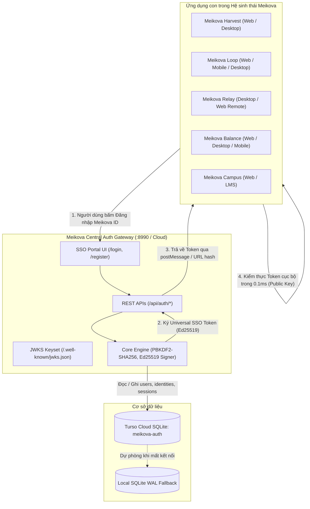

# Meikova Auth

<div align="center">


[](https://github.com/Meikova/meikova-auth/releases)
[](https://github.com/Meikova/meikova-auth)
[](https://www.python.org/)
[](https://turso.tech/)
[](https://tools.ietf.org/html/rfc8032)
[](LICENSE)

**Cổng xác thực tập trung, Universal Single Sign-On (SSO) Ed25519 và trung tâm quản lý danh tính đa nền tảng cho hệ sinh thái Meikova.**

[Cổng Đăng Nhập Trực Tuyến](https://meikova-auth.onrender.com) | [Tài Liệu Kỹ Thuật](docs/GOOGLE-CREDENTIALS-GUIDE.md) | [Báo Lỗi](https://github.com/Meikova/meikova-auth/issues)

</div>

---

## 1. Tổng quan hệ thống

Meikova Auth là dịch vụ Identity Provider (IdP) và Universal Single Sign-On (SSO) Gateway tập trung cho toàn bộ hệ sinh thái Meikova Platform (Meikova Harvest, Meikova Loop, Meikova Relay, Meikova Balance, Meikova Campus...).

- **Universal SSO Ed25519**: Token đăng nhập được ký mật mã bất đối xứng Ed25519 (RFC 8032). Tất cả ứng dụng con tự kiểm thực token cục bộ trong **0.1ms** bằng Public Key mà không cần gọi API qua mạng.
- **Cơ sở dữ liệu phân tán Turso Cloud libSQL**: Dữ liệu tài khoản, phiên đăng nhập và định danh được đồng bộ thời gian thực qua Turso Cloud với cơ chế tự động chuyển vùng dự phòng (Fallback) về SQLite WAL cục bộ.
- **Quản lý phiên đa nền tảng**: Cung cấp giao diện quản lý phiên đăng nhập thiết bị theo thời gian thực, thu hồi phiên từ xa, tạo mã truy cập cá nhân (PAT) và tích hợp Google Identity Services (GIS) 1-click.
- **Giao diện Ambient Dark & Zero-Dependency**: Xây dựng theo phong cách Ambient Dark thuần khiết, 100% Inline Vector SVG, Zero-Native-Inputs và không phụ thuộc framework frontend nặng nề.

---

## 2. Tính năng nổi bật

### Cổng đăng nhập tập trung (Universal SSO Portal)

- **Đăng ký và Đăng nhập duy nhất**: Một tài khoản Meikova ID truy cập toàn bộ hệ sinh thái sản phẩm trên mọi nền tảng (Web, Desktop, Mobile PWA).
- **Liên kết danh tính Google OAuth 1-Click**: Tích hợp Google Identity Services với cơ chế tự động liên kết tài khoản dựa trên email đã xác minh.
- **Khóa bảo mật Ed25519 & JWKS chuẩn RFC 8037**: Xuất bản bộ khóa công khai tại `/.well-known/jwks.json` và `/api/auth/keys` cho phép các ứng dụng OAuth2/OIDC chuẩn hóa tích hợp.

### Quản trị bảo mật và Phiên làm việc (Session Hub)

- **Giám sát thiết bị kết nối**: Liệt kê chi tiết các phiên đăng nhập đang hoạt động kèm địa chỉ IP, User-Agent và thời gian hoạt động gần nhất.
- **Thu hồi phiên từ xa (Remote Session Revocation)**: Cho phép đăng xuất từng thiết bị cụ thể hoặc đăng xuất toàn bộ các thiết bị khác chỉ với một nút bấm.
- **Quản lý Personal Access Tokens (PAT)**: Tạo mã token truy cập API (`mkv_pat_<hex>`) với cơ chế băm SHA-256 an toàn tuyệt đối.
- **Nhật ký kiểm toán bất biến (Audit Trail)**: Ghi lại đầy đủ mọi hoạt động đăng nhập, đổi mật khẩu và cấp quyền ứng dụng.

### Khám phá mạng và Kết nối thiết bị di động

- **Dynamic Host Discovery**: Tự động bóc tách Tailscale IP, LAN IP và Public Active URL thông qua endpoint chuẩn `GET /api/host-info`.
- **Tạo mã QR kết nối nhanh**: Cung cấp mã QR định dạng SVG offline hoặc URL redirect kết nối thiết bị di động tức thì.
- **Dynamic Release Asset Resolver**: Phân giải liên kết tải bộ cài đặt native qua `GET /api/download/app/{target}` đối soát trực tiếp với GitHub Release API mới nhất.

---

## 3. Kiến trúc hệ thống và luồng dữ liệu



---

## 4. Công nghệ sử dụng

- **Core Backend**: Python 3.11+, Standard Library `http.server` tối ưu hiệu năng cao, zero-framework boilerplate.
- **Bảo mật & Mật mã**: Cryptography (`ed25519`, `serialization`), PBKDF2-SHA256 (600,000 rounds), Base64URL.
- **Cơ sở dữ liệu**: Turso Cloud libSQL (`libsql-client`), Local SQLite WAL mode.
- **Frontend & UI**: Vanilla JavaScript (ES Modules), Ambient Dark CSS (OKLCH Dynamic Lighting), 100% Inline Vector SVG.
- **Desktop Shell**: Microsoft Edge WebView2 (`meikova_auth_desktop.py`).
- **Triển khai & CI/CD**: Render Cloud (`render.yaml`), GitHub Actions.

---

## 5. Hướng dẫn phát triển (Development)

### Yêu cầu hệ thống

- Python 3.11+
- Git

### Khởi chạy môi trường thử nghiệm

1. **Clone mã nguồn và cài đặt dependencies**:

```bash
git clone https://github.com/Meikova/meikova-auth.git
cd meikova-auth
pip install -r requirements.txt
```

2. **Chạy bộ kiểm thử tự động xác nhận chất lượng**:

```bash
# Chạy bộ test 40 điểm kiểm định Auth Gateway:
python tests/test_auth_server.py

# Chạy kiểm thử tuân thủ tài sản thương hiệu:
python tests/test_brand_assets.py
```

3. **Khởi chạy máy chủ cục bộ**:

```bash
python server.py --host 0.0.0.0 --port 8990
```

4. **Khởi chạy ứng dụng Desktop native (WebView2)**:

```bash
python meikova_auth_desktop.py
```

---

## 6. Giao tiếp kiểm thực Token (Universal SSO Client Integration)

Ứng dụng con không cần gửi request kiểm tra token qua mạng mỗi lần xử lý. Quá trình kiểm thực diễn ra 100% offline trong **~0.1ms** qua Public Key:

### Python Client Integration

```python
import base64
import json
import time
from cryptography.hazmat.primitives.asymmetric import ed25519
from cryptography.hazmat.primitives import serialization

def verify_sso_token(token: str, public_key_pem: str) -> dict | None:
    parts = token.strip().split(".")
    if len(parts) != 3:
        return None
    h_b64, p_b64, sig_b64 = parts
    try:
        signing_input = f"{h_b64}.{p_b64}".encode("utf-8")
        rem = len(sig_b64) % 4
        sig = base64.urlsafe_b64decode(sig_b64 + ("=" * (4 - rem) if rem else ""))
        pub = serialization.load_pem_public_key(public_key_pem.encode("utf-8"))
        pub.verify(sig, signing_input)
        payload = json.loads(base64.urlsafe_b64decode(p_b64 + ("=" * ((4 - len(p_b64) % 4) % 4))).decode("utf-8"))
        if payload.get("exp") and payload["exp"] < time.time():
            return None
        return payload
    except Exception:
        return None
```

### Node.js / TypeScript Client Integration

```javascript
const crypto = require('crypto');

function verifySsoToken(token, publicKeyPem) {
  const parts = String(token).trim().split('.');
  if (parts.length !== 3) return null;
  const [hB64, pB64, sigB64] = parts;
  try {
    const signingInput = Buffer.from(`${hB64}.${pB64}`);
    const sig = Buffer.from(sigB64, 'base64url');
    const isValid = crypto.verify(null, signingInput, publicKeyPem, sig);
    if (!isValid) return null;
    const payload = JSON.parse(Buffer.from(pB64, 'base64url').toString('utf8'));
    if (payload.exp && payload.exp < Math.floor(Date.now() / 1000)) return null;
    return payload;
  } catch {
    return null;
  }
}
```

---

## 7. Cấu hình và Biến môi trường (.env)

| Tên biến | Bắt buộc | Mô tả | Giá trị mẫu |
| :--- | :---: | :--- | :--- |
| `AUTH_TURSO_DATABASE_URL` | Có | Địa chỉ Turso Cloud SQLite | `https://meikova-auth-m3ik18dp.aws-ap-northeast-1.turso.io` |
| `AUTH_TURSO_AUTH_TOKEN` | Có | JWT Token kết nối Turso Cloud | `eyJhbGciOiJFZERTQSIsInR5cCI6IkpXVCJ9...` |
| `AUTH_PRIVATE_KEY_B64` | Có | Khóa riêng tư Ed25519 (Base64 PEM) | `LS0tLS1CRUdJTiBQUklWQVRFIEtFWS0tLS0t...` |
| `AUTH_PUBLIC_KEY_B64` | Có | Khóa công khai Ed25519 (Base64 PEM) | `LS0tLS1CRUdJTiBQVUJMSUMgS0VZLS0tLS0...` |
| `PORT` | Không | Cổng dịch vụ HTTP (Mặc định: 8990 / Render: 10000) | `8990` |
| `CORS_ORIGINS` | Không | Danh sách tên miền CORS được phép (`*` hoặc phân tách bằng phẩy) | `*` |

---

## 8. Giấy phép bản quyền (License)

Dự án được phát hành theo giấy phép **MIT License**.
Bản quyền thuộc về **Meikova Auth Team © 2026**.

---

## 9. Hệ sinh thái Meikova

- [Meikova Harvest](https://github.com/Meikova/meikova-harvest) - Hệ sinh thái trích xuất và tải đa phương tiện đa nền tảng.
- [Meikova Loop](https://github.com/Meikova/meikova-loop) - DJ mashup và infinite soundscape engine chạy trên web, desktop và mobile.
- [Meikova Relay](https://github.com/Meikova/meikova-relay) - Điều khiển máy tính từ xa độ trễ thấp, outbound-only.
- [Meikova Auth](https://github.com/Meikova/meikova-auth) - Cổng xác thực tập trung, Universal SSO Ed25519 và quản lý danh tính đa nền tảng.
- [Meikova Balance](https://github.com/Meikova/meikova-balance) - Quản lý tài chính cá nhân, chia hóa đơn nhóm và trợ lý AI đa tầng.
- [Meikova Campus](https://github.com/Meikova/meikova-campus) - Nền tảng thương mại khóa học, phân quyền Google Drive tự động và LMS trực tuyến.
- [Meikova Exchange](https://github.com/Meikova/meikova-exchange) - Sàn giao dịch B2B cho dự án phần mềm, mã nguồn và tài sản số.
- [Meikova Traverse](https://github.com/Meikova/meikova-traverse) - Trình duyệt tệp tin cục bộ, SFTP, WebDAV và quản lý lưu trữ đa nền tảng.
- [Meikova Shield](https://github.com/Meikova/meikova-shield) - Hệ thống phòng thủ an ninh mạng và phát hiện web defacement bằng học máy lai ghép.
- [Meikova Vision](https://github.com/Meikova/meikova-vision) - Bộ công cụ xử lý ảnh RAW, ghép đa phơi sáng HDR và tone mapping chuyên nghiệp.
- [Meikova Flow](https://github.com/Meikova/meikova-flow) - Động cơ trích xuất, biến đổi, nạp dữ liệu (ETL) và tự động hóa luồng báo cáo.
