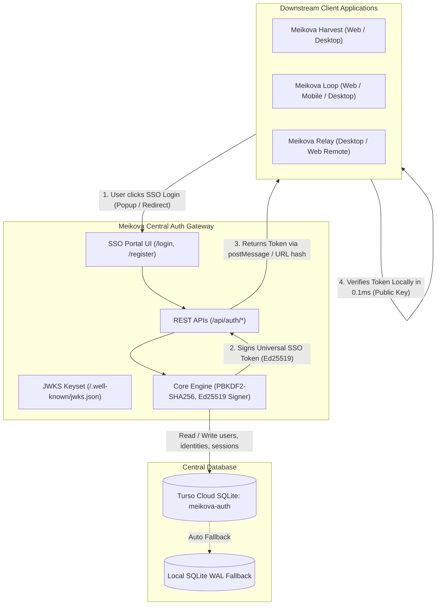

# Meikova Auth Gateway & Universal Identity Service

Centralized Identity Provider (IdP) and Universal Single Sign-On (SSO) Gateway for the Meikova Ecosystem (**Meikova Relay**, **Meikova Loop**, **Meikova Harvest**).

Designed with zero external service dependencies for verification, leveraging asymmetric Ed25519 cryptographic tokens and Turso Cloud distributed SQLite over encrypted libSQL HTTPS pipelines.

---

## Architecture Highlights



- **Universal SSO Tokens:** Tokens are cryptographically signed using asymmetric Ed25519 (RFC 8032) private keys with a 30-day validity window.
- **Zero-Roundtrip Client Verification:** All downstream applications verify tokens locally in **~0.1ms** using the public key without needing HTTP requests to the Gateway.
- **Turso Cloud SQLite Backend:** Fully distributed, highly available database (`meikova-auth`) with automatic failover to local SQLite WAL storage.
- **Unified Account Provisioning:** Single credential set works across all Meikova desktop, web, and mobile apps. Supports username/email login and 1-Click Google OAuth GIS with automatic identity linking.
- **Standard JWKS Keyset:** Exposes RFC 8037 standard JWKS keyset at `/.well-known/jwks.json` and `/api/auth/keys`.
- **Zero-Emoji & Ambient Dark UI:** Standalone SSO portal interface built with Meikova Ambient Dark design system and 100% inline SVG craftsmanship.

---

## API Endpoints

| Method | Endpoint | Description |
| :--- | :--- | :--- |
| `GET` | `/` | Service health status and metadata index |
| `GET` | `/health` | Healthcheck (database connectivity & loaded key status) |
| `GET` | `/login` | Ambient Dark SSO Portal login interface |
| `GET` | `/register` | Ambient Dark SSO Portal registration interface |
| `POST` | `/api/auth/register` | Centralized user registration (PBKDF2-SHA256, 100k rounds) |
| `POST` | `/api/auth/login` | Centralized user authentication (returns Ed25519 JWT) |
| `POST` | `/api/auth/google` | Google OAuth identity linking and automatic provisioning |
| `GET` | `/api/auth/me` | Fetch active user profile via `Authorization: Bearer <token>` |
| `GET/POST` | `/api/auth/verify` | Gateway token validation endpoint for external services |
| `GET` | `/api/auth/keys` | Public Key export (PEM and JWKS format) |
| `GET` | `/.well-known/jwks.json` | RFC 8037 standard JWKS keyset for standard OAuth2/OIDC clients |

---

## Universal SSO Integration (Client Side)

Client applications do not need to call the Auth Gateway on every request. Verification happens entirely offline in ~0.1ms using the public key.

### Python Client Verification

```python
import base64
import json
import time
from cryptography.hazmat.primitives.asymmetric import ed25519
from cryptography.hazmat.primitives import serialization

def verify_sso_token(token: str, public_key_pem: str) -> dict | None:
    parts = token.strip().split(".")
    if len(parts) != 3:
        return None
    h_b64, p_b64, sig_b64 = parts
    try:
        signing_input = f"{h_b64}.{p_b64}".encode("utf-8")
        rem = len(sig_b64) % 4
        sig = base64.urlsafe_b64decode(sig_b64 + ("=" * (4 - rem) if rem else ""))
        pub = serialization.load_pem_public_key(public_key_pem.encode("utf-8"))
        pub.verify(sig, signing_input)
        payload = json.loads(base64.urlsafe_b64decode(p_b64 + ("=" * ((4 - len(p_b64) % 4) % 4))).decode("utf-8"))
        if payload.get("exp") and payload["exp"] < time.time():
            return None
        return payload
    except Exception:
        return None
```

### Node.js Client Verification

```javascript
const crypto = require('crypto');

function verifySsoToken(token, publicKeyPem) {
  const parts = String(token).trim().split('.');
  if (parts.length !== 3) return null;
  const [hB64, pB64, sigB64] = parts;
  try {
    const signingInput = Buffer.from(`${hB64}.${pB64}`);
    const sig = Buffer.from(sigB64, 'base64url');
    const isValid = crypto.verify(null, signingInput, publicKeyPem, sig);
    if (!isValid) return null;
    const payload = JSON.parse(Buffer.from(pB64, 'base64url').toString('utf8'));
    if (payload.exp && payload.exp < Math.floor(Date.now() / 1000)) return null;
    return payload;
  } catch {
    return null;
  }
}
```

---

## Deployment to Render Cloud

### Blueprint Deployment (Recommended)
This repository includes a `render.yaml` Blueprint definition for automated deployment.

1. Connect this repository to your Render account at [dashboard.render.com](https://dashboard.render.com).
2. Select **New +** -> **Blueprint**.
3. Render automatically reads `render.yaml` and provisions the Python Web Service.
4. Provide the required secret environment variables listed below.

### Manual Web Service Configuration

1. In Render Dashboard, click **New +** -> **Web Service**.
2. Select the `Meikova/meikova-auth` repository.
3. Configure the service settings:
   - **Environment:** `Python 3`
   - **Build Command:** `pip install -r requirements.txt`
   - **Start Command:** `python server.py`
   - **Health Check Path:** `/health`
   - **Port:** `10000`

### Required Environment Variables

| Variable Name | Required | Description | Example / Value |
| :--- | :---: | :--- | :--- |
| `AUTH_TURSO_DATABASE_URL` | Yes | Turso Cloud Database URL | `https://meikova-auth-m3ik18dp.aws-ap-northeast-1.turso.io` |
| `AUTH_TURSO_AUTH_TOKEN` | Yes | Turso Cloud JWT Auth Token | `eyJhbGciOiJFZERTQSIsInR5cCI6IkpXVCJ9...` |
| `AUTH_PRIVATE_KEY_B64` | Yes | Base64-encoded Ed25519 Private Key PEM | `LS0tLS1CRUdJTiBQUklWQVRFIEtFWS0tLS0t...` |
| `AUTH_PUBLIC_KEY_B64` | Yes | Base64-encoded Ed25519 Public Key PEM | `LS0tLS1CRUdJTiBQVUJMSUMgS0VZLS0tLS0...` |
| `PORT` | Yes | HTTP Server listening port | `10000` |
| `CORS_ORIGINS` | No | Allowed CORS origins (comma-separated or `*`) | `*` |

---

## Local Development & Testing

```bash
# Clone the repository
git clone https://github.com/Meikova/meikova-auth.git
cd meikova-auth

# Install dependencies
pip install -r requirements.txt

# Run the 21-point automated verification suite
python tests/test_auth_server.py

# Start local server on port 8990
python server.py --host 0.0.0.0 --port 8990
```

---

## Repository Metadata

- **Organization:** [Meikova](https://github.com/Meikova)
- **Live Portal:** `https://meikova-auth.onrender.com`
- **Supported Clients:** Meikova Harvest, Meikova Loop, Meikova Relay
- **Cryptographic Standard:** Ed25519 (RFC 8032), RFC 8037 JWKS
- **License:** MIT
