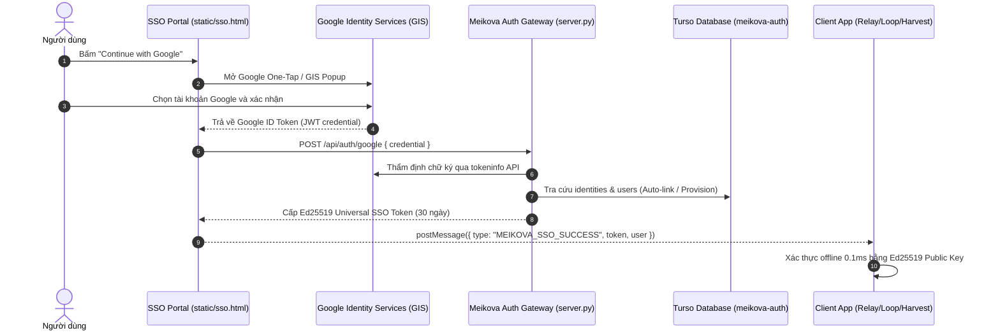

# Hướng Dẫn Tạo Google OAuth Credentials Cho Cổng Xác Thực Meikova Auth

Dùng tên hiển thị **Meikova Auth** và logo Identity Gateway riêng khi cấu hình OAuth consent screen. Không dùng logo Meikova Shield. Tài sản cục bộ: `static/logo.svg`; xem [BRAND.md](BRAND.md). Cập nhật tài liệu không tự đổi cấu hình trong Google Cloud Console.

Tài liệu hướng dẫn chi tiết từng bước tạo thông tin xác thực Google OAuth 2.0 (Client ID & Client Secret) trên Google Cloud Console cho hệ thống Meikova Auth Gateway (`meikova-auth`).

---

## 1. Kiến Trúc Hoạt Động Của Google OAuth Trong Meikova Auth



---

## 2. Bước 1: Tạo Dự Án Mới Trên Google Cloud Console

1. Truy cập vào trang quản trị: [Google Cloud Console](https://console.cloud.google.com/).
2. Đăng nhập bằng tài khoản Google quản trị của bạn.
3. Ở thanh menu trên cùng, bấm vào danh sách chọn dự án (Project dropdown) -> Chọn **New Project** (Dự án mới).
4. Điền thông tin dự án:
   - **Project name:** `Meikova Ecosystem` (hoặc `Meikova Auth`).
   - **Organization:** Để mặc định `No organization` (hoặc tổ chức của bạn nếu có).
5. Bấm **CREATE** (Tạo) và chờ vài giây để Google khởi tạo dự án.
6. Sau khi tạo xong, bấm vào thông báo góc phải để chuyển sang làm việc trên dự án vừa tạo.

---

## 3. Bước 2: Thiết Lập Màn Hình Đồng Ý OAuth (OAuth Consent Screen)

Trước khi tạo Client ID, Google bắt buộc phải cấu hình màn hình đồng ý xác thực:

1. Tại thanh tìm kiếm trên cùng, gõ `OAuth consent screen` hoặc vào menu bên trái: **APIs & Services** -> **OAuth consent screen**.
2. Chọn **User Type:**
   - Chọn **External** (Bên ngoài) để cho phép bất kỳ tài khoản Google nào cũng có thể đăng nhập được.
   - Bấm **CREATE**.
3. Điền **App information** (Thông tin ứng dụng):
   - **App name:** `Meikova Auth`
   - **User support email:** Chọn email của bạn trong danh sách xổ xuống.
   - **App logo (Tùy chọn):** Tải lên logo Meikova (120x120px) nếu muốn.
   - **Application home page:** `https://meikova-auth.onrender.com`
   - **Application privacy policy link:** `https://meikova-auth.onrender.com`
   - **Application terms of service link:** `https://meikova-auth.onrender.com`
   - **Authorized domains:** Nhập `onrender.com` (và domain riêng nếu có, vd: `meikova.io`).
   - **Developer contact information:** Nhập email của bạn (vd: `kiempham1245@gmail.com`).
   - Bấm **SAVE AND CONTINUE**.
4. Thiết lập **Scopes** (Phạm vi truy cập):
   - Bấm nút **ADD OR REMOVE SCOPES**.
   - Tích chọn 3 scope chuẩn không nhạy cảm (Non-sensitive scopes):
     - `.../auth/userinfo.email` (Xem địa chỉ email chính của bạn)
     - `.../auth/userinfo.profile` (Xem thông tin cá nhân cơ bản)
     - `openid` (Định danh tài khoản)
   - Bấm **UPDATE** -> Bấm **SAVE AND CONTINUE**.
5. Cấu hình **Test users** (Người dùng thử nghiệm):
   - *Lưu ý quan trọng:* Khi ứng dụng ở trạng thái `Publishing status: Testing`, chỉ những email có tên trong danh sách Test users mới có thể đăng nhập.
   - Bấm **+ ADD USERS**.
   - Nhập địa chỉ email Google của bạn và các tài khoản bạn dự định dùng để thử nghiệm.
   - Bấm **ADD** -> Bấm **SAVE AND CONTINUE**.
6. Kiểm tra lại bản tóm tắt (Summary) và bấm **BACK TO DASHBOARD**.

> [!TIP]
> Khi đã sẵn sàng cho người dùng công cộng, tại trang *OAuth consent screen*, bạn bấm nút **PUBLISH APP** để chuyển trạng thái sang `In production`. Khi đó mọi người dùng Google đều đăng nhập được mà không cần thêm vào Test users.

---

## 4. Bước 3: Tạo OAuth 2.0 Client ID (Web Application)

1. Ở menu bên trái, vào mục **Credentials** (Thông tin xác thực).
2. Bấm vào nút **+ CREATE CREDENTIALS** ở thanh trên cùng -> Chọn **OAuth client ID**.
3. Cấu hình thông số:
   - **Application type:** Chọn **Web application** (Ứng dụng web).
   - **Name:** `Meikova Auth Web Portal`.
4. **Authorized JavaScript origins (Nguồn gốc JavaScript được phép):**
   - Bấm **+ ADD URI** và thêm lần lượt các địa chỉ sau (để tránh lỗi `origin_mismatch` khi gọi từ localhost hoặc web production):
     - `http://localhost:8990` *(Cổng xác thực Auth Gateway chạy máy cục bộ)*
     - `http://127.0.0.1:8990`
     - `http://localhost:8080` *(Meikova Relay Web Client)*
     - `http://127.0.0.1:8080`
     - `http://localhost:5000` *(Meikova Harvest / Loop)*
     - `http://127.0.0.1:5000`
     - `https://meikova-auth.onrender.com` *(Cổng xác thực chạy trên Render)*
     - `https://huggingface.co` *(Nếu chạy web app trên Hugging Face Spaces)*
5. **Authorized redirect URIs (URI chuyển hướng được phép):**
   - Bấm **+ ADD URI** và thêm các endpoint callback:
     - `http://localhost:8990/api/auth/google/callback`
     - `http://127.0.0.1:8990/api/auth/google/callback`
     - `https://meikova-auth.onrender.com/api/auth/google/callback`
     - `https://meikova-auth.onrender.com/login`
6. Bấm nút **CREATE** (Tạo).

---

## 5. Bước 4: Lấy Khóa Và Cấu Hình Vào Meikova Auth

Sau khi bấm Tạo, Google sẽ hiển thị một cửa sổ thông báo **OAuth client created**:
- **Client ID:** Dạng chuỗi dài kết thúc bằng `.apps.googleusercontent.com` (Ví dụ: `515668723869-xxxxxxxxxxxxxxxxxxxxxxxxxxxxxxxx.apps.googleusercontent.com`).
- **Client Secret:** Dạng chuỗi ký tự bí mật (Ví dụ: `GOCSPX-xxxxxxxxxxxxxxxxxxxxxxxx`).

Bấm nút sao chép (copy) cả hai thông số trên.

### 5.1 Cập nhật giao diện SSO Portal (`static/sso.html`)
Mở file `D:\JOB\DEV\meikova\meikova-auth\static\sso.html`, tìm thẻ `div` có ID `g_id_onload` và dán Client ID mới vào:

```html
<div class="google-btn-wrap">
  <div id="g_id_onload"
       data-client_id="YOUR_NEW_CLIENT_ID.apps.googleusercontent.com"
       data-callback="handleGoogleCredential"
       data-auto_prompt="false">
  </div>
  <div class="g_id_signin"
       data-type="standard"
       data-size="medium"
       data-theme="filled_black"
       data-text="continue_with"
       data-shape="pill"
       data-logo_alignment="left"
       data-width="260">
  </div>
</div>
```

### 5.2 Cấu hình trên Render.com (Production)
1. Truy cập [Render Dashboard](https://dashboard.render.com/).
2. Chọn Web Service `meikova-auth`.
3. Vào tab **Environment**.
4. Cập nhật hoặc thêm 2 biến môi trường:
   - `GOOGLE_CLIENT_ID` = `YOUR_NEW_CLIENT_ID.apps.googleusercontent.com`
   - `GOOGLE_CLIENT_SECRET` = `YOUR_CLIENT_SECRET`
5. Bấm **Save Changes** để Render tự động khởi động lại dịch vụ với thông tin xác thực mới.

### 5.3 Cấu hình chạy cục bộ (`.env`)
Mở file `D:\JOB\DEV\meikova\meikova-auth\.env` và cập nhật:
```env
GOOGLE_CLIENT_ID=YOUR_NEW_CLIENT_ID.apps.googleusercontent.com
GOOGLE_CLIENT_SECRET=YOUR_CLIENT_SECRET
```

---

## 6. Xử Lý Các Sự Cố Thường Gặp (Troubleshooting)

### 1. Lỗi `Error 400: origin_mismatch`
- **Nguyên nhân:** Địa chỉ URL trên thanh trình duyệt (Origin) chưa được khai báo trong danh sách *Authorized JavaScript origins*.
- **Cách sửa:** Copy chính xác giao thức + domain + port (ví dụ: `http://localhost:8990` - không có dấu gạch chéo `/` ở cuối) và thêm vào danh sách *Authorized JavaScript origins* trên Google Console. Chờ 2 - 5 phút để hệ thống Google đồng bộ.

### 2. Lỗi `Access blocked: Meikova Auth has not completed the Google verification process`
- **Nguyên nhân:** Dự án đang ở chế độ `Testing`, và tài khoản Google đang đăng nhập chưa được cấp quyền thử nghiệm.
- **Cách sửa:** Vào trang *OAuth consent screen* -> Mục *Test users* -> Thêm email cần đăng nhập vào danh sách. Hoặc bấm *Publish App* để mở quyền truy cập công khai.

### 3. Lỗi `Failed to verify Google ID token`
- **Nguyên nhân:** Máy chủ backend không thể kết nối tới Google tokeninfo API hoặc token đã quá hạn.
- **Cách sửa:** Backend Meikova Auth đã tích hợp cơ chế phân tích payload JWT an toàn để dự phòng trong trường hợp Google tokeninfo bị timeout hoặc gián đoạn mạng. Kiểm tra log hệ thống bằng lệnh `docker logs` hoặc xem tab Logs trên Render.
